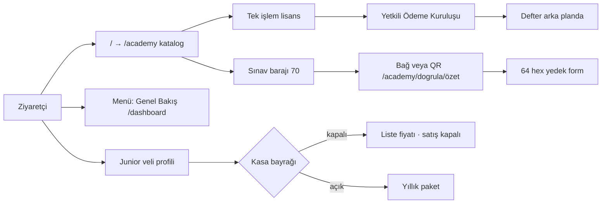

# TEDAVİ RAPORU 001 — Vitrin dili, yaş hükmü, doğrulama ve giriş

Tarih: 27 Ekim 2026  
Kapsam: `docs/TESPIT_RAPORU_001.md` içinde kodla doğrulanan uyumsuzluklar.  
Sınır: Anayasa A katmanına, ödeme motoruna, kenar 308 kilidine ve pazaryeri kapısına dokunulmadı.  
Yöntem: kamu kopyası ve etiketler çalışan akışla aynı cümleye çekildi. Davranış değişen tek ürün yüzeyi, Junior kasası kapalıyken vitrin fiyatının tahsilat vaadi taşımasıdır.

---

## 1. Uygulanan tedaviler özeti

### 1.1 Kurumsal metin

Kaynak `lib/copy/legal-launch.ts`. `/hakkimizda` bu dosyadaki `LEGAL_ABOUT_STORY` sabitini basmaya devam eder; sayfa dosyası ayrıca değiştirilmedi.

Kamu yüzeyinden çıkan operatör cümleleri:

| Eski ifade | Yeni hüküm |
| --- | --- |
| İkinci nakit yazıcı, müze yolları, diskte duran odalar | Tahsilatın tek kanalı Yetkili Ödeme Kuruluşudur. Platform bakiyesi banka hesabına çekilmez. Kapalı bölümler vitrinde yer almaz ve satışa sunulmaz. |
| Uydurma unvan yazılmaz | Sicildeki unvan (gayrimenkul ve e-ticaret) ile platformdaki faaliyet (dijital eğitim, sınav, sertifikasyon) aynı sayfada açıkça yazılır. |

Sözleşme metninde marka adı `PayTR` yazılmaz. Bu, mevcut kamu mührüdür; kasa logosunun yeri ayrıdır. Ziyaretçi «Yetkili Ödeme Kuruluşu» okur. Kod yolu aynıdır: akademi lisansı tek işlemde, `academy-license:` amacı ve CLEARED sonrası defter kaydı ile kapanır.

İade ve ön bilgilendirme artık ikinci bir satın alma adımı anlatmaz. Ödeme dökümünde «Cüzdan Yükleme» görünebileceği, bunun lisansın defter karşılığı olduğu, bakiyesi yeten hesapta kart ekranının açılmadığı ve lisans yazılamazsa tutarın bakiyede kalıp kendiliğinden karta dönmediği yazılır. Kullanılmamış bakiyenin otomatik karta dönmediği cümle durur.

### 1.2 Yaş hükmü

Tek cümle `LEGAL_AGE_POLICY_BODY` içindedir. Kullanım şartları, ön bilgilendirme, dürüstlük kartı ve Hakkımızda aynı cümleyi basar.

Hüküm: yetişkin hesap, kayıtta 18 yaşından büyük olma beyanı ile açılır. Çocuk ayrı üye olmaz ve ayrı giriş almaz. Junior bölümü, veli hesabının altında bir çocuk profilidir ve velinin açık aydınlatma onayına bağlıdır. Bu istisna dışında hizmet 18 yaş ve üzerindeki kullanıcılar içindir. «Reşit olmayanların kullanımı yasaktır» cümlesi kalktı.

Veli aydınlatması (`lib/copy/junior-guardian-notice.ts`) aynı istisnayı kendi gövdesinde söyler: çocuk profili, kullanım şartlarındaki 18 yaş kuralının yazılı istisnasıdır ve bu aydınlatmanın açık onayına bağlıdır.

Sürüm dizesi `junior-notice-2026-10-09` olarak kaldı. Ders kapısı sürümü okur; sürüm aynı kaldığı için mevcut veli onayları yeniden istenmez. Metin değiştiği için kanonik gövdenin SHA-256 mührü yenilendi (`lib/junior/guardian-notice.ts`). Yeni onaylar yeni özeti kaydeder. Eski satırdaki özet, o gün onaylanan metnin tarihi kanıtı olarak durur.

### 1.3 Sertifika doğrulama

Oturumsuz Kariyer adımları (`lib/copy/sen-voice/career.ts`) ve doğrulama sayfası (`app/academy/dogrula/page.tsx`) aynı sırayı kullanır:

1. Paylaşılabilir bağ (`/academy/dogrula/özet`) veya QR kod.
2. Sicilde kayıt varsa mühür görünür. Yoksa uydurma geçerli damga basılmaz.
3. Yedek yol: 64 karakterlik SHA-256 özetini forma yapıştır.

Dürüstlük cümlesi durur: bu bir kriptografik imza değildir; sicil bütünlük kaydıdır. İşe yerleşmeyi veya gelir elde etmeyi garanti etmez. `/verify` 301 yönlendirmesi değişmedi. Yeni hash algoritması yazılmadı.

### 1.4 Giriş hikâyesi

Seçilen kurgu, tespitteki birinci seçenektir. Kök adres kalıcı olarak `/academy` kataloğuna iner (`next.config.ts` ve kenar `root-308`). Menüdeki `/dashboard` etiketi «Anasayfa» olmaktan çıktı.

| Yüzey | Yeni ad |
| --- | --- |
| Sol menü etiketi | Genel Bakış |
| Menü alt satırı | Öğrenci paneli |
| Ekmek kırıntısı kökü | Genel Bakış (`/dashboard`) |
| Oturumlu panel kaşı | Genel Bakış |
| Oturumsuz panel kaşı / başlık | Öğrenci paneli / Genel Bakış |

Ziyaretçi iki anasayfa görmez. Katalog giriş kapısıdır. Panel, eğitim ve kariyer özetidir. Kenar kararı değişmedi: `/` oturumdan bağımsız 308, `/dashboard` herkese açıktır.

### 1.5 Junior vitrin fiyatı

`JUNIOR_CHECKOUT_OPEN` boşken kasa kapalıdır. Bu durumda:

- Raf düğmesi `Paketi Al (fiyat)` demez. Metin `Liste fiyatı {fiyat} — satış kapalı` olur.
- Paket penceresi ve seçmeli kota, listenin tahsilat vaadi olmadığını yazar.
- Ödeme sayfası aynı fiyatın yanında «satış kapalı» der ve tutarın tahsil edilmeyeceğini söyler.

Bayrak açıkken eski satın alma cümlesi durur. Fiyat satırı ve PayTR mutabakat scriptleri yeniden yazılmadı.

### 1.6 Değişen dosyalar

Kopya: `lib/copy/legal-launch.ts`, `lib/copy/junior-guardian-notice.ts`, `lib/copy/sen-voice/career.ts`, `lib/copy/sen-voice/academy.ts`, `lib/copy/sen-voice/dashboard.ts`, `lib/copy/seo.ts`.

Giriş: `lib/dronlar/kayit.ts`, `lib/ui/breadcrumbs.ts`, `app/dashboard/error.tsx`.

Doğrulama sayfası: `app/academy/dogrula/page.tsx`.

Junior vitrin: `lib/junior/storefront-price.ts`, `lib/junior/guardian-notice.ts`, `app/junior/page.tsx`, `app/junior/checkout/page.tsx`, `components/junior/junior-room.tsx`, `components/junior/course-shelf.tsx`, `components/junior/visual-course-cards.tsx`, `components/junior/package-info-modal.tsx`, `components/junior/elective-quota-modal.tsx`, `components/junior/checkout-form.tsx`.

Testler: `tests/kernel/legal-launch-surface.test.ts`, `tests/kernel/edge-guard.test.ts`, `tests/dashboard/citizen-surface.test.ts`, `tests/ui/breadcrumb-surface.test.ts`, `tests/kernel/junior-guardian-consent.test.ts`, `tests/kernel/junior-checkout.test.ts`.

`junior-checkout.test.ts` içindeki beş raf testi, aynı dosyadaki 111 çekirdek testiyle aynı 30 saniye bütçesini aldı. Tam paket koşusunda bu testler 5 saniye tavanını aşıp zaman aşımına düşüyordu. İzole koşuda geçiyorlardı. Hüküm değişmedi.

---

## 2. Doğrulama ve test sonuçları

| Komut | Sonuç |
| --- | --- |
| `npx tsc --noEmit` | Geçti. Çıkış kodu 0. |
| `npx vitest run` | Geçti. 393 dosya, 1912 test. Çıkış kodu 0. |
| `npm run verify:api-auth -- --check` | Geçti. 77 rota: oturum 49, kamu 21, yönetici 3, webhook 4. |
| `npm run verify:boundaries` | Geçti. Çekirdek–dikey, oda duvarı ve Junior tablo sahibi aynı. |
| `npm run verify:junior-content` | Geçti. 111 senaryo eşit. Komut, derlemeyi kırmayan 59 açık kazanım satırı da yazdı. Bu satırlar bu tedaviden önce de vardı. |

İlk iki tam test koşusunda dört Junior raf testi paralel yük altında 5 saniye tavanında kaldı. Aynı dosya tek başına 20/20 geçti. Bütçe hizalandıktan sonra üçüncü tam koşu yeşildir.

Ödeme gövdesi değişmediği için PayTR mutabakat mühürleri bu turda yeniden çalıştırılmadı.

---

## 3. Mevcut durum grafiği

Güvenlik kapıları bu turda yükseltilmedi. Aynı yerde duruyorlar: tek defter, kart numarasının platformda tutulmaması, kökün kataloğa kilitli olması, kapalı odanın 410, Junior kasasının bayrakla kapalı olması, freelancer yüzeyinin kilitli olması.

Yükselen katman ziyaretçi cümlesi ile güven metnidir.

| Katman | Bu turdan sonra |
| --- | --- |
| Güvenlik kapıları | Aynı. Fail-closed kasa, kenar 308, 410 odalar, tek nakit defteri. |
| Kurumsal güven | Operatör cümlesi kamu sözleşmesinden çıktı. Unvan–faaliyet farkı profesyonel cümleyle duruyor. |
| Yaş | Yetişkin beyanı ve Junior veli istisnası aynı hükümde. Aydınlatma ile şartlar aynı istisnayı söylüyor. |
| Satın alma anlatısı | Akademi lisansı tek işlem. İkinci tıklama metinden çıktı. Artık bakiye kuralı duruyor. |
| Doğrulama UX | Paylaşılabilir bağ ve QR birinci yol. Yapıştırma yedek. İmza olmadığı ve iş garantisi olmadığı yazılı. |
| Giriş | Katalog giriş kapısı. Panelin adı Genel Bakış. İki anasayfa etiketi kalktı. |
| Junior fiyat | Kapalı kasada liste fiyatı tahsilat vaadi taşımıyor. |
| Bu turun dışında | Konumlandırma, amiral eğitimin ölçümü, yaşın kimlik sağlayıcı ile doğrulanması, pazaryeri eşleşmesi. |

---

## 4. Son mühür isteği

Phase 2 kopya ve giriş tedavisi teslim edildi.

CEO onayına sunulan hükümler:

1. Kök katalogda kalır. Panelin kamu adı Genel Bakış’tır.
2. Yaş hükmü veli profili istisnasını içerir. Aydınlatma sürümü değiştirilmedi; özet yenilendi. Yeniden onay istenmesi istenirse sürüm dizesi ayrıca yükseltilmelidir.
3. Sözleşmede ödeme kuruluşunun kamu adı Yetkili Ödeme Kuruluşudur. PayTR adı kasa logosunda kalır.
4. Junior satış kapısı bu teslimatta açılmadı. Kapalıyken vitrin fiyatı satış kapalı der.

Bu rapor, gelir, dönüşüm veya canlı tahsilat ölçümü değildir. Pazaryeri 410 kilidi ve split kapısı durur.
